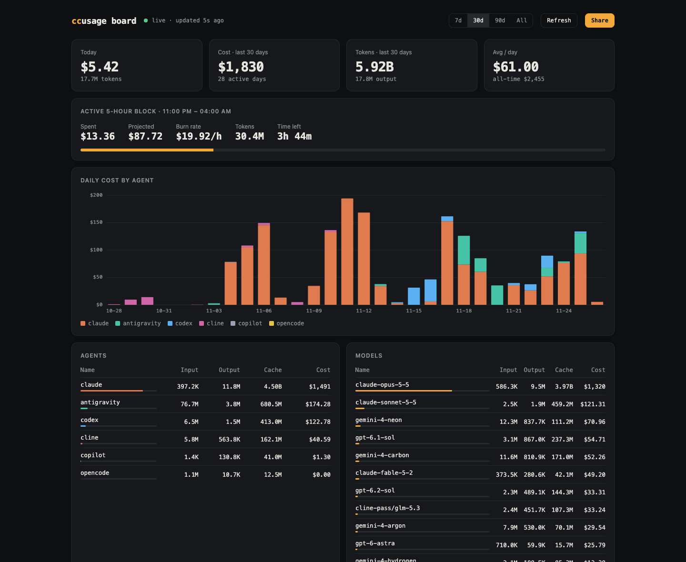
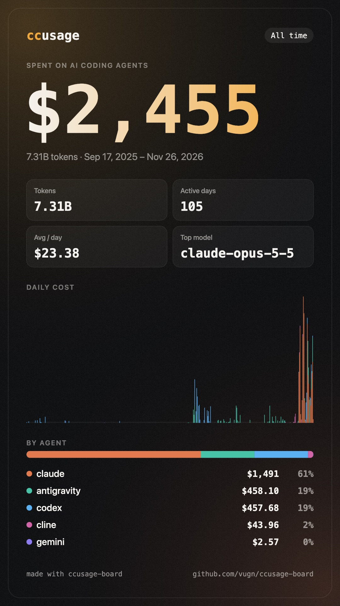
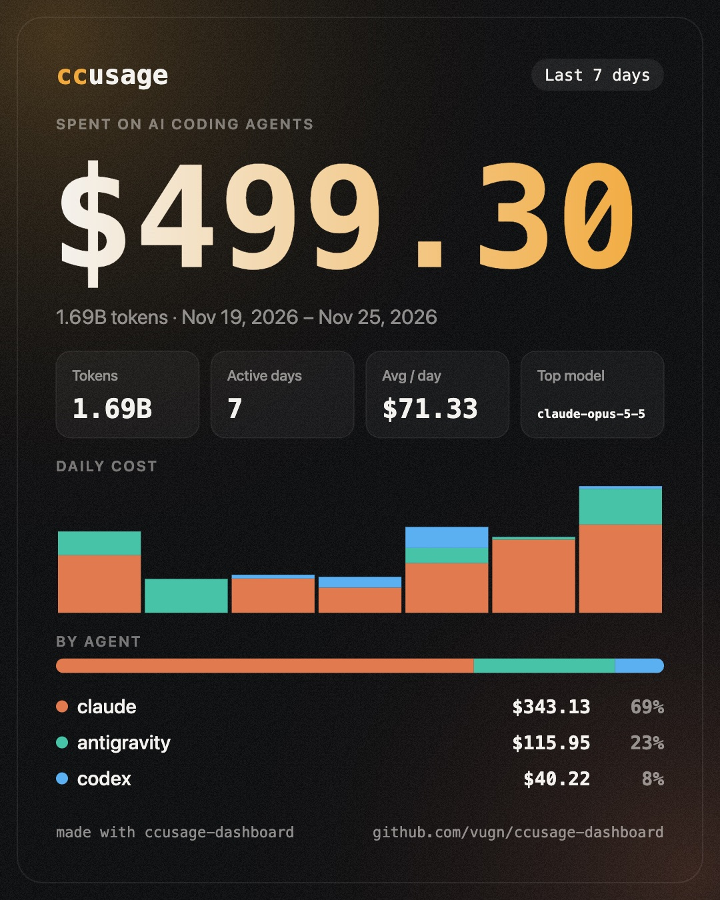
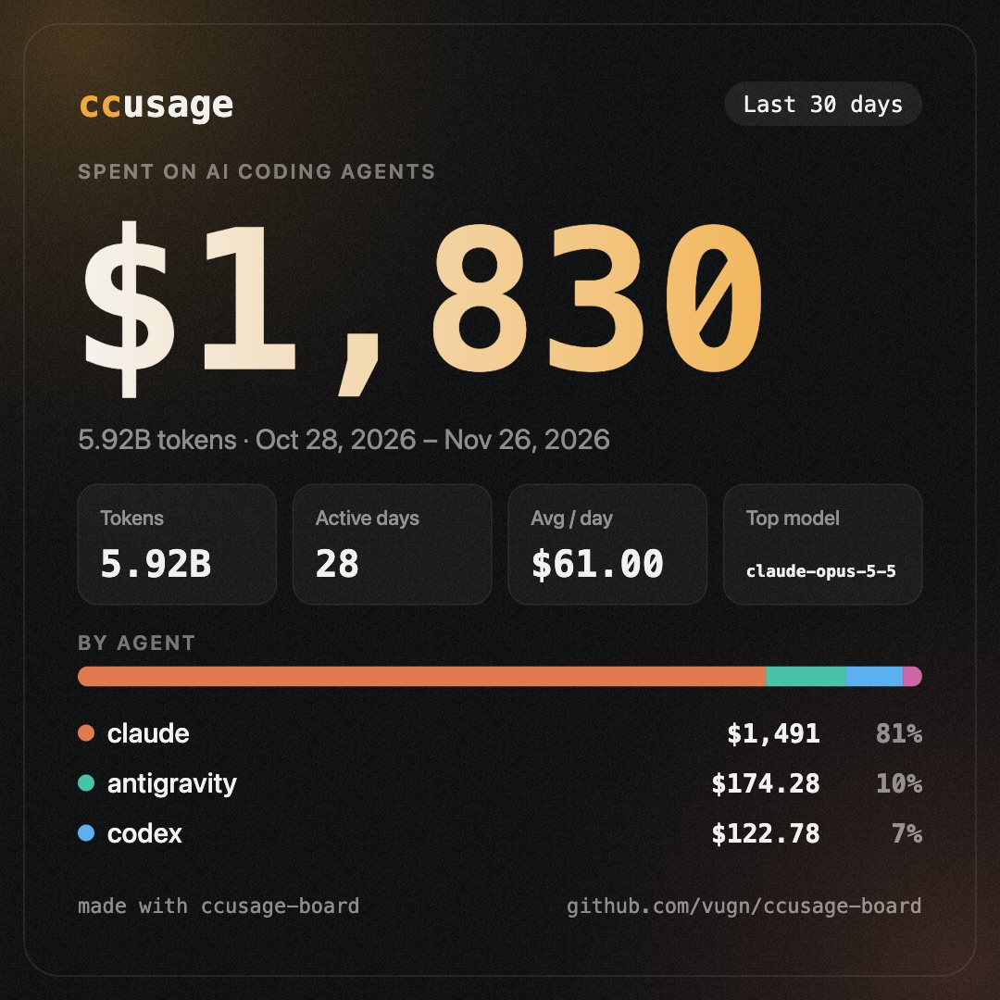
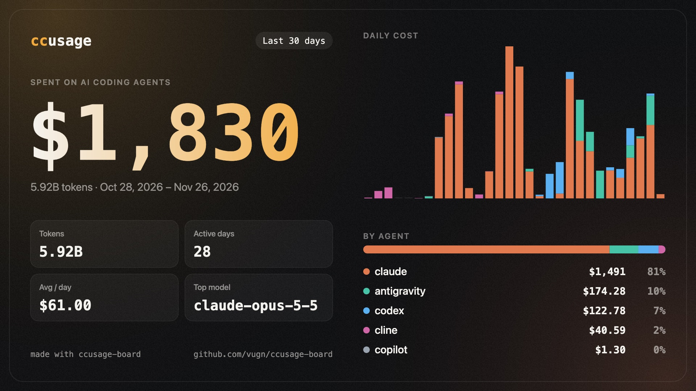

# ccusage-board

A live, local web dashboard for [ccusage](https://github.com/ryoppippi/ccusage). See what Claude Code, Codex, Gemini, OpenCode, Cline, Copilot and other AI coding agents cost you, updated in real time, and turn it into a share card for your story.

> Unofficial community project. Not affiliated with ccusage or its author.



## Features

- **Live.** Re-reads your local usage every 15 seconds and pushes updates to the page. No reloads.
- **Opens itself.** Run `ccusage-board` and pick: open in browser, run in the background, or terminal only.
- **Runs in the background.** Start it once and it keeps running after you close the terminal. Then just open `http://127.0.0.1:3939` whenever you want to check.
- **Every agent in one view.** Daily cost chart stacked by agent, per-agent and per-model breakdowns, and 7d / 30d / 90d / all-time ranges.
- **Active 5-hour block.** Spend so far, projected cost, burn rate and time left.
- **Share cards.** Export your usage as a PNG sized for Instagram, TikTok and WhatsApp stories, feed posts, or widescreen. Download it, copy it to the clipboard, or use the native share sheet on supported devices.
- **Private.** The server listens on `127.0.0.1` only. Your usage data never leaves your machine.
- **Small.** One Node file and one HTML file. The only dependency is ccusage itself.

## Share cards

Click **Share** in the dashboard and pick a format. The card uses the currently selected date range.

| Story 9:16 | Post 4:5 | Square 1:1 |
|---|---|---|
|  |  |  |

**Wide 16:9**: for X, LinkedIn, slides or a big screen



| Format | Size | Good for |
|---|---|---|
| Story 9:16 | 1080 × 1920 | Instagram, TikTok and WhatsApp stories |
| Post 4:5 | 1080 × 1350 | Instagram feed |
| Square 1:1 | 1080 × 1080 | X, Threads, Discord |
| Wide 16:9 | 1920 × 1080 | LinkedIn, slides, desktop |

## Install

Requires Node.js 18 or newer. ccusage comes bundled, so you don't need to install it separately.

```bash
npx ccusage-board
```

or install it globally:

```bash
npm install -g ccusage-board
ccusage-board
```

## Usage

Run `ccusage-board` with no arguments and it asks how you want to run it:

```
  ccusage-board  live dashboard for your AI coding agent usage

  1) Open in browser     run here and open http://127.0.0.1:3939  (Ctrl+C to stop)
  2) Run in background   keep running after you close this terminal, then open the browser
  3) Terminal only       run here without opening a browser

  Choose 1-3 [1]:
```

| Choice | What happens |
|---|---|
| **1. Open in browser** (default) | Starts the server in this terminal and opens the dashboard in your browser. Press Ctrl+C to stop. |
| **2. Run in background** | Starts the server as a background process and opens your browser. It keeps running after you close the terminal, until you run `ccusage-board stop`. Bookmark **http://127.0.0.1:3939** and check it any time. |
| **3. Terminal only** | Starts the server in this terminal without opening a browser. |

If a background server is already running, `ccusage-board` skips the menu and just opens the dashboard.

## Commands

Skip the menu with a command:

| Command | What it does |
|---|---|
| `ccusage-board` | Show the menu above |
| `ccusage-board run` | Run in the foreground without asking (Ctrl+C to quit) |
| `ccusage-board start` | Run in the background until you stop it |
| `ccusage-board open` | Open the running dashboard in your browser |
| `ccusage-board stop` | Stop the background server |
| `ccusage-board restart` | Restart the background server |
| `ccusage-board status` | Show whether it is running, plus its URL and log file |

The background server writes its PID and log to `~/.ccusage-board/`. It doesn't come back by itself after a reboot, so run `ccusage-board start` again.

When the output isn't a terminal (for example under a process manager), `ccusage-board` runs in the foreground without the menu.

## Configuration

Set these with environment variables, for example `PORT=4000 ccusage-board start`.

| Variable | Default | Description |
|---|---|---|
| `PORT` | `3939` | HTTP port |
| `HOST` | `127.0.0.1` | Set to `0.0.0.0` to open the dashboard from your phone on the same Wi-Fi. This exposes your usage data to everyone on that network. |
| `INTERVAL` | `15` | Seconds between refreshes |
| `CCUSAGE_BIN` | bundled ccusage | Custom command to run ccusage, e.g. `bunx ccusage` |

## How it works

`server.js` runs `ccusage daily --json --by-agent` and `ccusage blocks --active --json` on an interval, keeps the latest result in memory, and streams it to the browser over Server-Sent Events (`/events`). The page draws the charts and share cards itself with SVG and Canvas. No frameworks, no build step.

| Endpoint | |
|---|---|
| `GET /` | The dashboard |
| `GET /events` | Live updates (SSE) |
| `GET /api/usage` | Latest usage as JSON |
| `POST /api/refresh` | Re-run ccusage now |
| `GET /?card=story&range=30` | Render just a share card (`story`, `post`, `square`, `wide`; `range` in days, `0` = all time) |

## Development

```bash
git clone https://github.com/vugn/ccusage-board
cd ccusage-board
npm install
npm start
```

Edit `public/index.html` and reload the page. Restart the server after changing `server.js`.

## Credits

Built by [Gusti Randa](https://github.com/vugn). Usage data comes from [ccusage](https://github.com/ryoppippi/ccusage) by [@ryoppippi](https://github.com/ryoppippi).

## License

[MIT](LICENSE)
